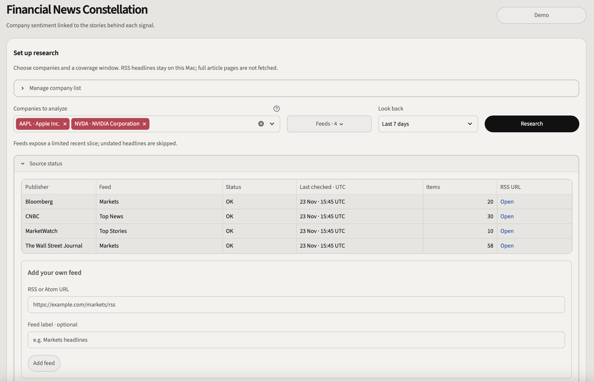
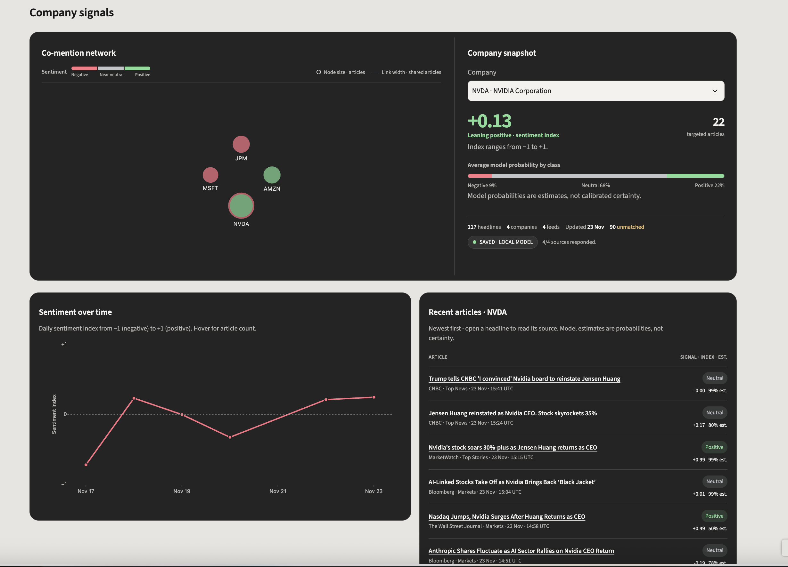

# Financial News Constellation

A local Streamlit tool for inspecting sentiment toward named companies across financial news. It connects a target-aware classifier to source-linked article evidence, a co-mention network, and a sentiment timeline.

The default view is an empty research workspace; fictional demo article text is available from the `Demo` button. If a local checkpoint is present, the dashboard scores that text with the model and labels the result `MODEL SCORES · FICTIONAL TEXT`. Without a checkpoint, it shows hand-authored illustrative probabilities and labels them accordingly. A fresh Git checkout does not include model weights or the downloaded SEntFiN data.

## Screenshots

**Research setup** — choose companies and feeds, set a date range, and inspect or add RSS sources.



**Company signals** — explore the co-mention network, sentiment snapshot, trend, and article evidence.



## Quick start

Requirements: Python 3.10 or later. Apple Silicon acceleration uses PyTorch MPS; current PyTorch releases require macOS 14 or later for MPS. The project does not bundle model weights.

```bash
python3 -m venv .venv
source .venv/bin/activate
python -m pip install --upgrade pip
python -m pip install -r requirements.txt
streamlit run app.py
```

To use local-model scores in a fresh checkout, first train the classifier:

1. Download `SEntFiN.csv` from the [SEntFiN repository](https://github.com/pyRis/SEntFiN) into `data/`.
2. Run `python scripts/train_model.py --data data/SEntFiN.csv`.
3. Restart Streamlit. The checkpoint is saved under `models/financial-target-distilbert/` and is ignored by Git.

The first training run downloads the public DistilBERT base checkpoint from Hugging Face. Training selects MPS when available and otherwise runs on CPU. Defaults are three epochs, batch size 8, and maximum sequence length 96; use `--batch-size 4` if unified-memory pressure is high.

## What it does

Press `Research` to fetch dated headlines and summaries from selected feeds in the local catalog, or add your own RSS/Atom URL inside **Source status**. Custom URLs are stored locally and are not contacted until Research is pressed. You can also upload a CSV. The app removes duplicate stories, maps company names and ticker aliases, and scores sentiment for each company target. For longer text it selects sentences mentioning that company and includes neighboring context. The model receives a text span and a named company as a pair, so two companies in one article can receive different labels.

```mermaid
flowchart LR
    accTitle: News Sentiment Analysis Flow
    accDescr: User-selected RSS or CSV articles are normalized and matched to company targets. A target-conditioned DistilBERT classifier scores evidence text, then the app aggregates scores into a company graph, timeline, and source-linked coverage board.

input["Curated RSS or CSV"] --> normalize["Normalize and deduplicate"]
    normalize --> match["Match company aliases"]
    match --> context["Select target evidence text"]
    context --> model["DistilBERT: text + target"]
    model --> article_score["Article / company probabilities"]
    article_score --> aggregate["Company and date summaries"]
    aggregate --> output["Constellation + timeline + evidence board"]
```



Choose target companies in the setup panel. `Manage company list` lets you edit the local `data/companies.csv` table or add a ticker, display name, and `|`-separated aliases through form fields. When a CSV includes a `companies` column, targets can also be supplied directly; separate `company` or `ticker` columns are accepted.

The RSS catalog is seeded from `data/rss_sources.csv` into the local SQLite store. Users can select a subset from the compact `Feeds` picker and add custom URLs from Source status. Each `Research` run checks the chosen feeds, filters dated items by the requested lookback window, and saves headlines, summaries, source links, and model outputs locally. The catalog is curated, not a certification of accuracy, and RSS feeds may expose only a limited recent slice.

## Data and methodology

### Training data

The training command uses [SEntFiN 1.0](https://arxiv.org/abs/2305.12257), a human-labeled financial headline dataset with 10,753 headlines and 14,404 entity-sentiment annotations. A headline can assign different sentiment to different companies, which makes it a better fit for this task than a sentence-only polarity label.[^sentfin]

The dataset is not bundled in a fresh checkout. This workspace’s downloaded copy is ignored by Git; the upstream repository includes an MIT license. Check the dataset and base-model terms before redistributing data or derived weights.[^sentfin-repo]

### Model and input processing

- Base encoder: `distilbert/distilbert-base-uncased`, fine-tuned as a three-class sequence classifier. Its model card lists Apache-2.0.[^distilbert]
- Input: `(financial text span, company target)` token pair.
- Labels: negative, neutral, positive.
- Optimization: full fine-tuning with AdamW, linear learning-rate decay, gradient clipping, and validation macro F1 for best-epoch selection.
- Device: Apple MPS when available, with CPU fallback. Apple Silicon PyTorch uses the shared-memory MPS backend; check `torch.backends.mps.is_available()` in the installed environment.[^mps]
- Training output: local model files, held-out evaluation JSON, and test predictions. These files are not committed.

Stories are scored separately for each matched company. The app averages sentence-context probabilities within each article/company pair, then reports a mean company sentiment index:

```text
sentiment index = mean(P(positive) − P(negative))
```

Node color shows sentiment, node size shows the number of unique articles, and an undirected edge counts articles in which two companies were both mentioned. The force-directed layout groups shared coverage; node position is not a measure of financial distance, correlation, or causation. When no companies are co-mentioned, nodes use a stable ring for readability.

### Evaluation

Headlines are expanded into target-specific examples before splitting. All labels from the same normalized headline stay in one partition, preventing a headline with multiple company labels from leaking across train and test. The split is approximately 70/10/20 for training, validation, and held-out test. The training report records macro F1, per-class precision/recall/F1, class counts, confusion matrix, and individual test predictions.

This workspace has a local baseline checkpoint and evaluation report; the model weights and dataset are ignored by Git, so a fresh checkout must download the CSV and run the training command above. On 2026-11-22, a three-epoch MPS run selected epoch 2 using validation macro F1 (0.8948) and reached **0.8522 held-out macro F1** on 2,887 target-labeled headline examples. Per-class F1 was 0.859 negative, 0.842 neutral, and 0.855 positive. The run’s `evaluation.json` records the dataset SHA-256, split sizes, class counts, confusion matrix, and per-example predictions.

SEntFiN evaluates headline sentiment; it does not establish accuracy on full article bodies or on every publisher. A manually reviewed article sample is still needed for deployment-source validation. Softmax probabilities are not calibrated certainty.

## Input formats and privacy

For CSV, provide at least `title` or `text`. Useful optional columns are `published_at` (or `date`), `source`, `url`, and `companies`. A company list can use `|`, comma, or semicolon separators. Missing publication dates remain unknown rather than being filled with a fabricated time.

RSS loading is manual; the app does not poll feeds in the background. The research workspace stores its bundled catalog, user-added feeds, source health checks, and research results in `data/financial_news.sqlite3`; CSV uploads remain in Streamlit session memory. RSS headlines and summaries are analyzed locally; full article pages are not fetched by the Research button. No remote inference service is used.

## Limitations

- Demo article text is fictional. Scores are either model predictions on that text or explicitly labeled illustrative fallback values when the checkpoint is unavailable.
- Company recognition uses the local alias registry rather than general-purpose named-entity recognition; add aliases for the sources and companies you care about.
- Headline-trained sentiment may not transfer to long articles. Review source-specific examples and false positives before relying on aggregates.
- Co-mentions describe shared article coverage only. This tool does not forecast stock prices, measure market correlation, or make investment recommendations.
- The graph and aggregate scores summarize model outputs; they do not establish financial truth.

## Project files

| Path | Role |
| --- | --- |
| `app.py` | Streamlit dashboard and local input controls |
| `src/finnews/data.py` | Normalization, alias matching, target contexts, aggregation |
| `src/finnews/ingest.py` | RSS and optional robots-aware page extraction |
| `src/finnews/model.py` | Local MPS/CPU model inference |
| `src/finnews/graph.py` | Reproducible company network layout and interactive figure |
| `scripts/train_model.py` | SEntFiN preprocessing, local fine-tuning, evaluation |
| `data/rss_sources.csv` | Curated RSS feed catalog seeded into the local database |
| `data/companies.csv` | Editable ticker, company name, and alias registry |
| `data/financial_news.sqlite3` | Local source catalog, health checks, and saved research runs (created on launch) |
| `data/demo_*.csv` | Fictional article examples and illustrative scores |
| `static/fonts/` | Self-hosted Roboto Condensed metadata face and SIL Open Font License |

## References

See [REFERENCES.md](REFERENCES.md) for dataset, model, framework, and software citations.

[^sentfin]: Sinha, Kedas, Kumar, and Malo, “SEntFiN 1.0: Entity-Aware Sentiment Analysis for Financial News.” [arXiv:2305.12257](https://arxiv.org/abs/2305.12257).
[^sentfin-repo]: [Official SEntFiN repository](https://github.com/pyRis/SEntFiN), [CSV](https://github.com/pyRis/SEntFiN/blob/main/SEntFiN.csv), and [MIT license](https://github.com/pyRis/SEntFiN/blob/main/LICENSE).
[^distilbert]: [DistilBERT base uncased model card](https://huggingface.co/distilbert/distilbert-base-uncased).
[^mps]: [PyTorch MPS backend documentation](https://docs.pytorch.org/docs/main/notes/mps.html) and [Hugging Face Apple Silicon guide](https://huggingface.co/docs/transformers/main/apple_silicon).
